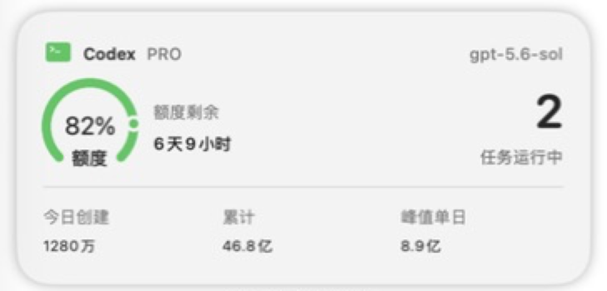

# Codex Pulse

[简体中文](README.zh-CN.md)

Codex Pulse is a native macOS WidgetKit dashboard for monitoring Codex quota windows, token activity, and locally active tasks.

> Unofficial community project. Codex Pulse is not affiliated with or endorsed by OpenAI.



_The preview uses synthetic demo data and contains no user account information._

## Highlights

- A real WidgetKit extension that appears in the macOS widget gallery.
- Four selectable widgets: Overview, Quota, Token, and Tasks.
- Native small, medium, and large system families.
- System typography, SF Symbols, semantic colors, and system-managed placement.
- Read-only access to local Codex data.
- A menu bar companion with manual refresh and an optional detail panel.
- No analytics, advertising, or project-owned cloud service.

## Widget choices

| Widget | Small | Medium | Large | Content |
| --- | :---: | :---: | :---: | --- |
| Codex Overview | ✓ | ✓ | ✓ | Quota remaining, active tasks, daily/lifetime/peak tokens |
| Codex Quota | ✓ | ✓ | ✓ | Primary and secondary windows, reset time, credits |
| Codex Token | ✓ | ✓ | ✓ | Tokens from today's created tasks, lifetime total, peak day |
| Codex Tasks | — | ✓ | ✓ | Task title, model, runtime, and token count |

## Requirements

- Apple Silicon Mac
- macOS 14 or later
- Codex Desktop or the Codex CLI installed in one of the supported locations
- Apple Command Line Tools when building from source

The current UI is primarily in Simplified Chinese.

The CLI lookup currently checks:

- `/Applications/ChatGPT.app/Contents/Resources/codex`
- `/opt/homebrew/bin/codex`
- `/usr/local/bin/codex`

## Install a release build

1. Download `Codex-Pulse-2.0.0-macos-arm64.zip` from the latest GitHub release.
2. Unzip it and move `Codex Pulse.app` into `~/Applications` or `/Applications`.
3. Open the app once. It runs as a menu bar app without a Dock icon.
4. If macOS blocks the locally signed build, use Finder's **Open** action or build from source.

The downloadable app is ad-hoc signed, not Developer ID signed or notarized.
Launch at login is **off by default** and can be enabled explicitly from the menu bar.

## Build from source

```bash
bash build.sh
```

The app is generated at:

```text
build/Codex Pulse.app
```

To install it for the current user:

```bash
mkdir -p "$HOME/Applications"
ditto "build/Codex Pulse.app" "$HOME/Applications/Codex Pulse.app"
open "$HOME/Applications/Codex Pulse.app"
```

The build script:

- Compiles the menu bar host and WidgetKit extension for arm64/macOS 14.
- Embeds the native app icon.
- Applies ad-hoc signatures to the extension and host.
- Runs `codesign --verify --deep --strict`.

## Add a desktop widget

1. Run Codex Pulse at least once.
2. Right-click an empty area of the desktop.
3. Choose **Edit Widgets…**.
4. Search for **Codex Pulse**.
5. Choose a widget and size, then drag it onto the desktop.

The medium Overview widget is the recommended starting point. Clicking a widget opens the detail panel.

## Data sources

Codex Pulse reads:

| Source | Purpose | Access |
| --- | --- | --- |
| Local Codex App Server | Plan, rate-limit windows, credits, token activity | Read-only RPC |
| `~/.codex/state_5.sqlite` | Local task metadata and token totals | Read-only SQLite |
| `~/.codex/sessions/**/*.jsonl` | Recent task start/stop markers | Read-only file scan |

The host publishes a compact snapshot to:

```text
~/Library/Application Support/Codex Pulse/widget-snapshot.json
```

The sandboxed WidgetKit extension has read-only access to that single application-support directory.

See [PRIVACY.md](PRIVACY.md) for the complete data-handling statement.

## Refresh behavior

- Local task data is polled approximately every 5 seconds.
- Account data is requested approximately every 3 minutes.
- An unchanged snapshot receives a low-frequency heartbeat.
- WidgetKit decides the final timeline refresh schedule, so widgets are not guaranteed to update every few seconds.

“Quota remaining” is the percentage left in the current time window, not a fixed token balance.

## Known limitations

- Codex App Server responses and local database schemas are not stable public integration contracts and may change.
- Active-task state is inferred from local events and recent activity.
- Account token activity may be delayed.
- Task widgets can display task titles. Remove them before screen sharing if titles are sensitive.
- Only Apple Silicon is currently built and tested.

## Verify a build

```bash
codesign --verify --deep --strict --verbose=2 "build/Codex Pulse.app"
"build/Codex Pulse.app/Contents/MacOS/CodexPulse" --probe
```

The probe prints a redacted local diagnostic summary. It does not include task
titles, task IDs, quota percentages, plan names, or token totals, and it does
not modify Codex data.

## Uninstall

1. Remove Codex Pulse widgets from the desktop.
2. Turn off **Launch at Login** from the menu bar if it was enabled.
3. Quit Codex Pulse.
4. Delete `Codex Pulse.app`.
5. Optionally remove generated local state:

```text
~/Library/Application Support/Codex Pulse/
~/Library/Preferences/com.local.codex-pulse.plist
```

## Contributing

Issues and pull requests are welcome. Please include:

- macOS and Codex versions
- The affected widget kind and size
- Reproduction steps
- A screenshot with private task titles removed

Do not publish credentials, raw session files, or a complete local Codex database in an issue.

## License

Codex Pulse is available under the [MIT License](LICENSE).

The original app icon and its source notes are documented in [ASSETS.md](ASSETS.md).
Codex and OpenAI are trademarks of their respective owners.
