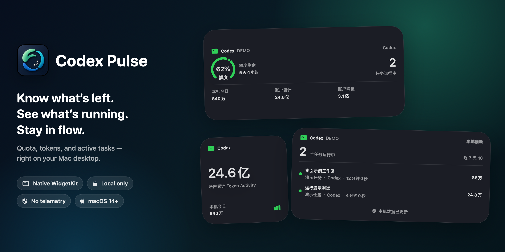

<h1 align="center">Codex Pulse</h1>

<p align="center">
  <strong>Know what’s left. See what’s running. Stay in flow.</strong>
</p>

<p align="center">
  Native macOS widgets for Codex quota, token activity, and active tasks — local-first, right on your desktop.
</p>

<p align="center">
  <a href="https://github.com/chifanjie/codex-pulse/releases/latest">
    
  </a>
  
  
  
  <a href="LICENSE">
    
  </a>
</p>

<p align="center">
  <a href="https://github.com/chifanjie/codex-pulse/releases/latest"><strong>Download latest release</strong></a>
  · <a href="#build-from-source">Build from source</a>
  · <a href="README.zh-CN.md">简体中文</a>
</p>

<p align="center">
  <sub>Unofficial community project. Not affiliated with or endorsed by OpenAI.</sub>
</p>

<p align="center">
  
</p>

<p align="center">
  <sub>Rendered at Retina resolution from the real SwiftUI and WidgetKit views using synthetic demo data.</sub>
</p>

| **Native WidgetKit** | **Everything at a glance** | **Local-first by design** |
| --- | --- | --- |
| Add it from the macOS widget gallery and place it like any system widget. | See quota remaining, token activity, and active tasks without switching windows. | Read-only access, no analytics, no ads, and no project-owned cloud service. |

## Pick the view you need

| Widget | Small | Medium | Large | Content |
| --- | :---: | :---: | :---: | --- |
| Codex Overview | ✓ | ✓ | ✓ | Quota remaining, active tasks, daily/lifetime/peak tokens |
| Codex Quota | ✓ | ✓ | ✓ | Primary and secondary windows, reset time, credits |
| Codex Token | ✓ | ✓ | ✓ | Local tokens used today, account lifetime total, peak day |
| Codex Tasks | — | ✓ | ✓ | Task title, model, runtime, and current-turn tokens |

## Requirements

- Apple Silicon Mac
- macOS 14 or later
- Codex Desktop or the Codex CLI installed in one of the supported locations
- Apple Command Line Tools when building from source

The current UI is primarily in Simplified Chinese.

The CLI lookup currently checks:

- `/Applications/ChatGPT.app/Contents/Resources/codex`
- `/opt/homebrew/bin/codex`
- `/usr/local/bin/codex`

## Install a release build

1. Download `Codex-Pulse-2.0.0-macos-arm64.zip` from the latest GitHub release.
2. Unzip it and move `Codex Pulse.app` into `~/Applications` or `/Applications`.
3. Open the app once. It runs as a menu bar app without a Dock icon.
4. If macOS blocks the locally signed build, use Finder's **Open** action or build from source.

The downloadable app is ad-hoc signed, not Developer ID signed or notarized.
Launch at login is **off by default** and can be enabled explicitly from the menu bar.

## Build from source

```bash
bash build.sh
```

The app is generated at:

```text
build/Codex Pulse.app
```

To install it for the current user:

```bash
mkdir -p "$HOME/Applications"
ditto "build/Codex Pulse.app" "$HOME/Applications/Codex Pulse.app"
open "$HOME/Applications/Codex Pulse.app"
```

The build script:

- Compiles the menu bar host and WidgetKit extension for arm64/macOS 14.
- Embeds the native app icon.
- Applies ad-hoc signatures to the extension and host.
- Runs `codesign --verify --deep --strict`.

## Add a desktop widget

1. Run Codex Pulse at least once.
2. Right-click an empty area of the desktop.
3. Choose **Edit Widgets…**.
4. Search for **Codex Pulse**.
5. Choose a widget and size, then drag it onto the desktop.

The medium Overview widget is the recommended starting point. Use the menu bar companion to refresh data or open the widget setup instructions.

## Data sources

Codex Pulse reads:

| Source | Purpose | Access |
| --- | --- | --- |
| Local Codex App Server | Plan, rate-limit windows, credits, token activity | Read-only RPC |
| `~/.codex/state_5.sqlite` | Local task metadata | Read-only SQLite |
| `~/.codex/sessions/**/*.jsonl` | Task state and deduplicated token deltas | Read-only file scan |

The host publishes a compact snapshot to:

```text
~/Library/Application Support/Codex Pulse/widget-snapshot.json
```

The sandboxed WidgetKit extension has read-only access to that single application-support directory.

See [PRIVACY.md](PRIVACY.md) for the complete data-handling statement.

## Refresh behavior

- Local task data is polled approximately every 5 seconds.
- Account data is requested approximately every minute after a successful read,
  with bounded retry backoff after failures.
- An unchanged snapshot receives a low-frequency heartbeat.
- WidgetKit decides the final timeline refresh schedule, so widgets are not guaranteed to update every few seconds.

“Quota remaining” is the percentage left in the current time window, not a fixed token balance.

## Known limitations

- Codex App Server responses and local database schemas are not stable public integration contracts and may change.
- Active-task state is inferred from local start/stop events.
- Account token activity may be delayed; when available, the widget shows the
  latest upstream statistics date. “Local today” is calculated independently
  from local session events.
- Task widgets can display task titles. Remove them before screen sharing if titles are sensitive.
- Only Apple Silicon is currently built and tested.

## Verify a build

```bash
codesign --verify --deep --strict --verbose=2 "build/Codex Pulse.app"
"build/Codex Pulse.app/Contents/MacOS/CodexPulse" --probe
```

The probe prints a redacted local diagnostic summary. It does not include task
titles, task IDs, quota percentages, plan names, or token totals, and it does
not modify Codex data.

## Uninstall

1. Remove Codex Pulse widgets from the desktop.
2. Turn off **Launch at Login** from the menu bar if it was enabled.
3. Quit Codex Pulse.
4. Delete `Codex Pulse.app`.
5. Optionally remove generated local state:

```text
~/Library/Application Support/Codex Pulse/
~/Library/Preferences/com.local.codex-pulse.plist
```

## Engineering tour

The data path is **read → merge → snapshot → display**. Local event statistics
and account-side statistics remain separate because they have different scopes.

- [LocalDataProvider](Sources/LocalDataProvider.swift): read-only local data and task activity.
- [AppServerClient](Sources/AppServerClient.swift): account-side protocol integration.
- [CodexDataStore](Sources/CodexDataStore.swift): state aggregation and refresh.
- [WidgetSnapshotWriter](Sources/WidgetSnapshotWriter.swift): the compact widget snapshot.
- [Regression tests](Tests/LocalDataProviderTests.swift): local data behavior.

This documentation refresh was prepared on Windows; it does not establish a new
macOS build or compatibility verification of the release binary.

## Contributing

Issues and pull requests are welcome. Please include:

- macOS and Codex versions
- The affected widget kind and size
- Reproduction steps
- A screenshot with private task titles removed

Do not publish credentials, raw session files, or a complete local Codex database in an issue.

## License

Codex Pulse is available under the [MIT License](LICENSE).

The original app icon and its source notes are documented in [ASSETS.md](ASSETS.md).
Codex and OpenAI are trademarks of their respective owners.
