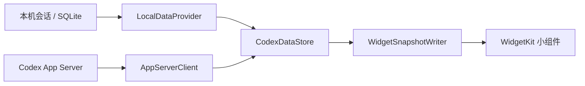

<h1 align="center">Codex Pulse</h1>

<p align="center">
  <strong>剩多少、跑什么，Mac 桌面一眼看清。</strong>
</p>

<p align="center">
  原生 macOS 小组件，集中显示 Codex 额度、Token 活动和运行任务；本地优先，不打断工作流。
</p>

<p align="center">
  <a href="https://github.com/chifanjie/codex-pulse/releases/latest">
    
  </a>
  
  
  
  <a href="LICENSE">
    
  </a>
</p>

<p align="center">
  <a href="https://github.com/chifanjie/codex-pulse/releases/latest"><strong>下载最新版</strong></a>
  · <a href="#从源码构建">从源码构建</a>
  · <a href="README.md">English</a>
</p>

<p align="center">
  <sub>非官方社区项目，与 OpenAI 无关联，也未获得 OpenAI 背书。</sub>
</p>

<p align="center">
  
</p>

<p align="center">
  <sub>使用真实 SwiftUI 与 WidgetKit 视图，以合成演示数据按 Retina 分辨率渲染。</sub>
</p>

| **原生 WidgetKit** | **关键信息一眼可见** | **本地优先设计** |
| --- | --- | --- |
| 从 macOS 小组件图库添加，像系统小组件一样选择尺寸和位置。 | 无需切换窗口，即可查看额度、Token 活动和运行任务。 | 只读访问，不含统计 SDK、广告或项目自有云服务。 |

## 按需要选择视图

| 类型 | 小 | 中 | 大 | 显示内容 |
| --- | :---: | :---: | :---: | --- |
| Codex 总览 | ✓ | ✓ | ✓ | 额度剩余、运行任务、今日/累计/峰值 Token |
| Codex 额度 | ✓ | ✓ | ✓ | 主要和次级窗口、重置时间、Credits |
| Codex Token | ✓ | ✓ | ✓ | 今日本机 Token、账户累计、峰值单日 Token |
| Codex 任务 | — | ✓ | ✓ | 任务标题、模型、运行时长和当前轮次 Token |

## 系统要求

- Apple Silicon Mac
- macOS 14 或更高版本
- 已安装 Codex Desktop 或 Codex CLI
- 从源码构建时需要 Apple Command Line Tools

当前会在以下位置查找 Codex CLI：

- `/Applications/ChatGPT.app/Contents/Resources/codex`
- `/opt/homebrew/bin/codex`
- `/usr/local/bin/codex`

## 安装发布版

1. 从最新 GitHub Release 下载 `Codex-Pulse-2.0.0-macos-arm64.zip`。
2. 解压后，将 `Codex Pulse.app` 移到 `~/Applications` 或 `/Applications`。
3. 运行一次应用。它不会显示 Dock 图标，只常驻菜单栏。
4. 如果 macOS 阻止这个本地签名版本，请在 Finder 中使用“打开”，或改为从源码构建。

下载版使用 ad-hoc 本地签名，没有 Developer ID 签名或 Apple 公证。
“登录时启动”默认关闭，需要用户在菜单栏中主动开启。

## 从源码构建

```bash
bash build.sh
```

构建结果位于：

```text
build/Codex Pulse.app
```

安装到当前用户：

```bash
mkdir -p "$HOME/Applications"
ditto "build/Codex Pulse.app" "$HOME/Applications/Codex Pulse.app"
open "$HOME/Applications/Codex Pulse.app"
```

构建脚本会同时编译菜单栏宿主和 WidgetKit 扩展，执行 ad-hoc 签名，并运行深层签名验证。

## 添加到桌面

1. 至少运行一次 Codex Pulse。
2. 在桌面空白处点按右键。
3. 选择“编辑小组件…”。
4. 搜索 `Codex Pulse`。
5. 选择类型和尺寸，拖到桌面。

推荐先添加“中号 Codex 总览”。需要刷新数据或查看添加指引时，可使用菜单栏入口。

## 数据来源

| 来源 | 用途 | 访问方式 |
| --- | --- | --- |
| 本地 Codex App Server | 套餐、额度窗口、Credits、Token activity | 只读 RPC |
| `~/.codex/state_5.sqlite` | 本地任务元数据 | 只读 SQLite |
| `~/.codex/sessions/**/*.jsonl` | 任务状态和去重后的 Token 增量 | 只读文件扫描 |

宿主应用会将精简快照写入：

```text
~/Library/Application Support/Codex Pulse/widget-snapshot.json
```

沙箱内的 WidgetKit 扩展只拥有这个应用支持目录的读取权限。完整说明见 [PRIVACY.md](PRIVACY.md)。

## 刷新机制

- 本地任务数据大约每 5 秒轮询一次。
- 账户数据成功读取后大约每分钟查询一次；失败时采用有上限的退避重试。
- 数据没有变化时也会低频写入心跳。
- 最终的小组件时间线刷新由 macOS WidgetKit 调度，不保证几秒一次。

“额度剩余”表示当前时间窗口的剩余百分比，不是固定 Token 余额。

## 已知限制

- Codex App Server 返回格式和本地数据库结构并非稳定的公共集成协议，未来可能变化。
- 任务运行状态来自本地开始/结束事件推断。
- 账户 Token activity 可能有统计延迟；可用时组件会显示上游统计截止日期。
  “今日本机”则独立根据本地会话事件计算。
- 任务小组件会显示任务标题；录屏或屏幕共享前请检查是否包含敏感内容。
- 当前只构建和测试了 Apple Silicon。

## 验证构建

```bash
codesign --verify --deep --strict --verbose=2 "build/Codex Pulse.app"
"build/Codex Pulse.app/Contents/MacOS/CodexPulse" --probe
```

探针只输出脱敏后的本地诊断摘要，不包含任务标题、任务 ID、套餐名称、额度百分比或 Token 总量，也不会修改 Codex 数据。

## 完整卸载

1. 从桌面移除 Codex Pulse 小组件。
2. 如果曾经开启，请从菜单栏关闭“登录时启动”。
3. 退出 Codex Pulse。
4. 删除 `Codex Pulse.app`。
5. 如需清除生成的本地状态，可删除：

```text
~/Library/Application Support/Codex Pulse/
~/Library/Preferences/com.local.codex-pulse.plist
```

## 工程导览



| 阅读入口 | 关注点 |
| --- | --- |
| [LocalDataProvider.swift](Sources/LocalDataProvider.swift) | 只读本地数据、事件合并与任务状态 |
| [AppServerClient.swift](Sources/AppServerClient.swift) | 账户状态读取与协议适配 |
| [CodexDataStore.swift](Sources/CodexDataStore.swift) | 状态整合与刷新 |
| [WidgetSnapshotWriter.swift](Sources/WidgetSnapshotWriter.swift) | 输出小组件需要的精简快照 |
| [LocalDataProviderTests.swift](Tests/LocalDataProviderTests.swift) | 数据处理回归测试 |

项目把本地事件统计与账户侧统计分开处理，避免把不同时间范围的数据混为同一口径。浏览源码时可以沿“读取 → 合并 → 快照 → 展示”追踪一次更新。

本次文档整理在 Windows 环境完成，未重新构建或验证 macOS 安装包；发行版本的支持范围与已知限制仍以下文为准。

## 参与贡献

欢迎提交 Issue 和 Pull Request。请附上：

- macOS 和 Codex 版本
- 受影响的小组件类型与尺寸
- 可复现步骤
- 已遮挡私人任务标题的截图

请勿在公开 Issue 中上传凭据、完整会话文件或完整的本地 Codex 数据库。

## 许可证

Codex Pulse 使用 [MIT License](LICENSE)。

原创应用图标及其来源说明见 [ASSETS.md](ASSETS.md)。Codex 和 OpenAI 商标归各自权利人所有。
